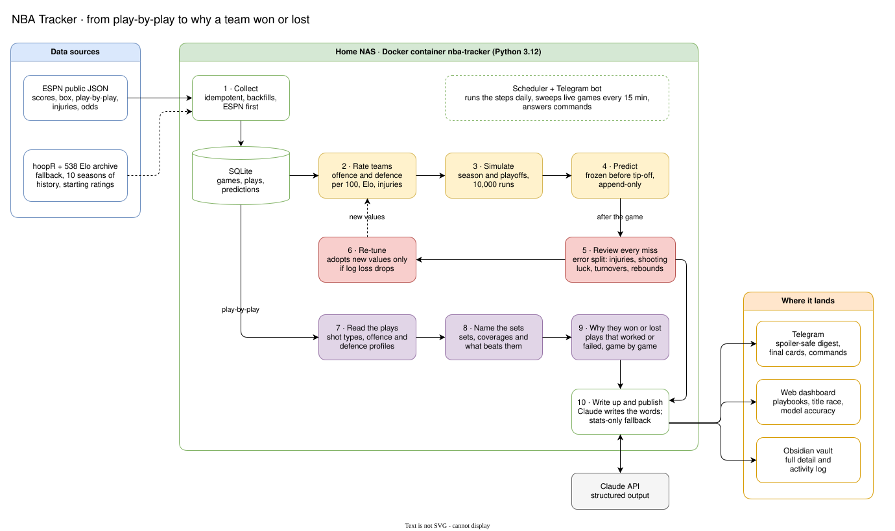

# NBA Tracker

A self-hosted NBA 2026-27 analysis bot. Its main job is to explain **why a team won or lost a game**: it reads the
play-by-play, works out each team's offence and defence, names the sets and coverages they ran, and shows which ones
worked and which failed. It also predicts every game and the title race, then reviews its own misses.

It runs in one Docker container on a home NAS (UGREEN) and reports to Telegram, a web dashboard and an Obsidian vault.



The diagram is a draw.io file. Open `docs/architecture.drawio.svg` in [draw.io](https://app.diagrams.net) to edit it.

## How it works

| Step | What happens | Code |
|---|---|---|
| 1. Collect | Pulls scores, box scores, play-by-play, injuries and odds from ESPN. Falls back to hoopR data if ESPN fails. Safe to re-run. | `nba/collector.py`, `nba/espn.py`, `nba/fallback.py` |
| 2. Rate teams | Offence and defence per 100 possessions, plus Elo, adjusted for who is injured. | `nba/ratings.py`, `nba/elo.py` |
| 3. Simulate | Plays out the rest of the season, the play-in and the playoffs 10,000 times. | `nba/simulate.py` |
| 4. Predict | Freezes a win probability for every game before tip-off. Predictions are append-only. | `nba/predictions.py` |
| 5. Review every miss | After the game, splits each prediction error into injuries, shooting luck, free throws, turnovers, rebounding and noise. | `nba/review.py`, `nba/scorecard.py` |
| 6. Re-tune | Searches for better model values and adopts them only if season log loss drops. Claude never sets a number. | `nba/tuning.py`, `nba/backtest.py` |
| 7. Read the plays | Classifies every shot from the play-by-play and builds each team's offence and defence profile against the league. | `nba/schemes.py`, `nba/players.py` |
| 8. Name the sets | Matches what a team ran to named sets and defensive coverages, with what beats each one. | `nba/playbook_kb.py` |
| 9. Why they won or lost | Game by game: the plays run, the defence played, what worked, what failed and the factors that decided it. | `nba/game_log.py` |
| 10. Write up and publish | Claude writes the words from the numbers (with a stats-only fallback). Results go to Telegram behind spoiler tags, the dashboard and the vault. | `nba/analyst.py`, `nba/telegram_pub.py`, `nba/web.py`, `nba/obsidian_pub.py` |

A scheduler runs the steps daily, sweeps live games every 15 minutes and checks injuries every 30 minutes. Each run
is exactly-once, so a restart never sends a second digest.

## Telegram commands

`/team` `/compare` `/whatif` `/player` `/game` `/plays` `/film` `/scorecard` `/status` `/ask` `/help`

Only the user ids in `ALLOWED_USER_IDS` can run them.

## Run it

```
python -m nba serve          # bot + scheduler (container default)
python -m nba daily|weekly|injury_check|backfill|predict|tune|backtest|health
python -m pytest tests       # offline, uses saved ESPN fixtures
```

Deploy: `sh deploy.sh` (needs `.deploy.env` with `NAS=user@host`). Secrets go in the NAS `.env` (see `env.example`).
Never commit `.env`.

## Data

- **ESPN public JSON API** for live data.
- **sportsdataverse/hoopR-nba-data** as the fallback and for ten seasons of history.
- **FiveThirtyEight Elo archive** (Neil-Paine-1/NBA-elo) for the starting ratings.
- NBA.com is not used. It is blocked from the home network.

## More docs

`docs/vault/` (App Overview, Changelog, Roadmap) and `docs/superpowers/specs/`.
